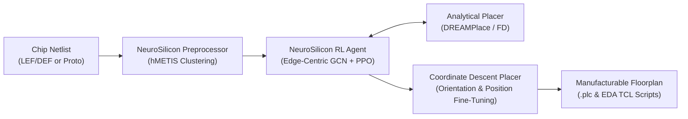
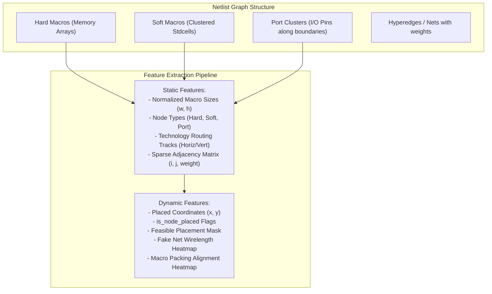
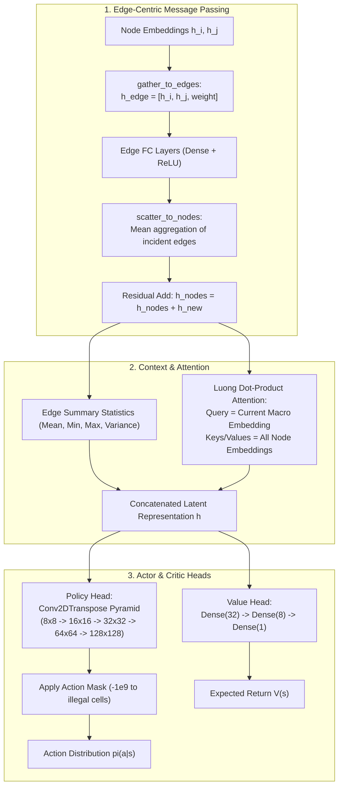
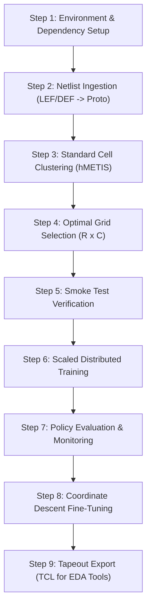
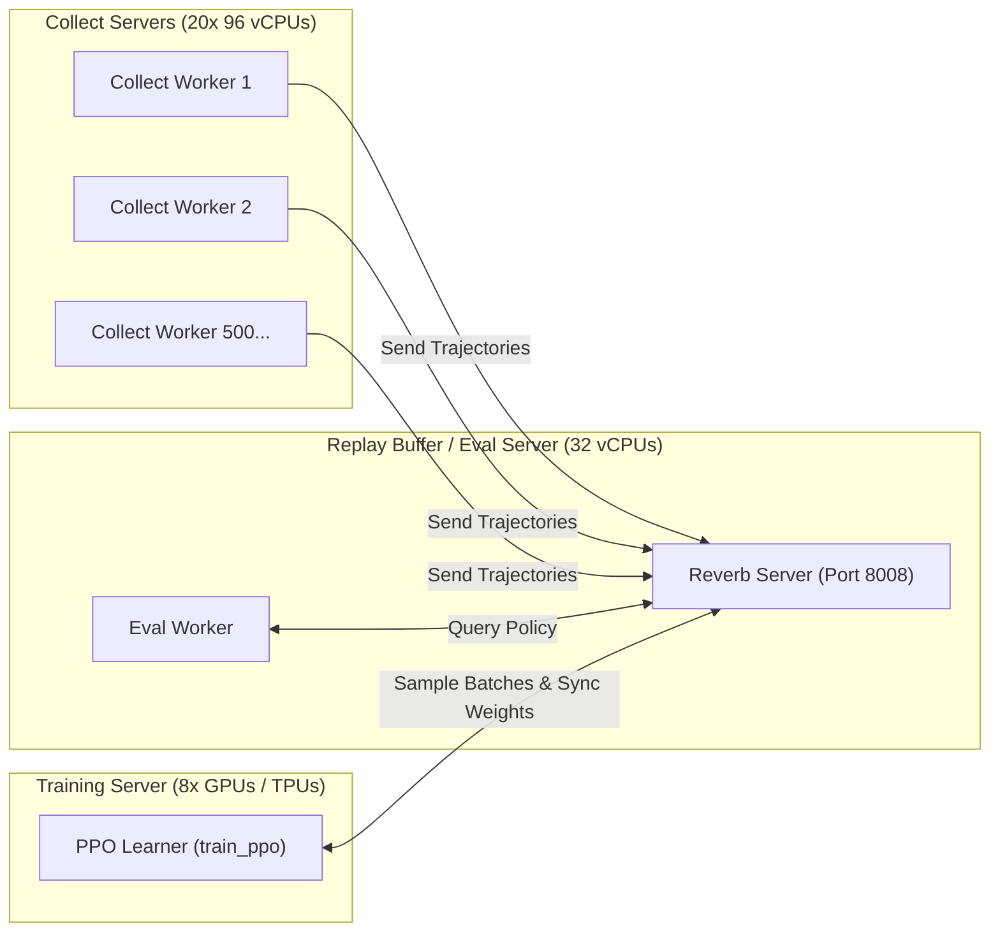

# NeuroSilicon: System Architecture, Operational Manual & "How It Works" Guide

Welcome to **NeuroSilicon** (formerly Circuit Training / AlphaChip) — an open-source, AI-driven framework for autonomous chip floorplanning and macro placement powered by distributed deep reinforcement learning.

This document provides a comprehensive operational and theoretical guide:
- **Part I: How It Works** — The end-to-end science, algorithms, Markov Decision Process (MDP), neural network architecture, and cost simulation.
- **Part II: What To Do (Step-by-Step Instructions)** — Practical operational manual covering installation, netlist preparation, clustering, distributed training, policy evaluation, local search post-processing, and commercial EDA export.

---

## Table of Contents
- [1. Executive Summary: What is NeuroSilicon?](#1-executive-summary-what-is-neurosilicon)
- [2. How It Works: The Science & Algorithms](#2-how-it-works-the-science--algorithms)
  - [2.1 The Floorplanning Problem as an MDP](#21-the-floorplanning-problem-as-an-mdp)
  - [2.2 Graph Representation & Feature Engineering](#22-graph-representation--feature-engineering)
  - [2.3 The Edge-Centric GCN & Attention Policy Network](#23-the-edge-centric-gcn--attention-policy-network)
  - [2.4 Analytical Placer Engines (DREAMPlace & Force-Directed)](#24-analytical-placer-engines-dreamplace--force-directed)
  - [2.5 The Multi-Objective Reward & Proxy Cost Formulation](#25-the-multi-objective-reward--proxy-cost-formulation)
  - [2.6 Coordinate Descent Post-Processing](#26-coordinate-descent-post-processing)
- [3. What To Do: Step-by-Step Operational Instructions](#3-what-to-do-step-by-step-operational-instructions)
  - [Step 1: Environment Setup & Prerequisites](#step-1-environment-setup--prerequisites)
  - [Step 2: Netlist Ingestion & Conversion](#step-2-netlist-ingestion--conversion)
  - [Step 3: Standard Cell Clustering (hMETIS Preprocessing)](#step-3-standard-cell-clustering-hmetis-preprocessing)
  - [Step 4: Grid Dimension Optimization](#step-4-grid-dimension-optimization)
  - [Step 5: Quick Validation (Single-Machine End-to-End Smoke Test)](#step-5-quick-validation-single-machine-end-to-end-smoke-test)
  - [Step 6: Running Scaled Distributed Training](#step-6-running-scaled-distributed-training)
  - [Step 7: Policy Evaluation & Visual Monitoring](#step-7-policy-evaluation--visual-monitoring)
  - [Step 8: Coordinate Descent Fine-Tuning](#step-8-coordinate-descent-fine-tuning)
  - [Step 9: Tapeout Export (TCL for Innovus / ICC2)](#step-9-tapeout-export-tcl-for-innovus--icc2)
- [4. Parameter Tuning & Troubleshooting Guide](#4-parameter-tuning--troubleshooting-guide)
- [6. Scale & Cost Policy (measured)](#6-scale--cost-policy-measured)

---

## 1. Executive Summary: What is NeuroSilicon?

In modern microchip physical design (e.g. CPUs, GPUs, TPUs, AI accelerators), a chip canvas contains:
1. **Macros (Hundreds)**: Pre-compiled dense blocks such as SRAM memory arrays and register files.
2. **Standard Cells (Millions to Billions)**: Basic logic gates (AND, OR, flip-flops, inverters).

Finding an optimal layout for macros is an NP-hard combinatorial problem. Placing macros poorly causes wire routing congestion, excessive wire delays, signal degradation, and power dissipation. 

**NeuroSilicon** replaces months of manual iterations by physical design engineers with an autonomous deep reinforcement learning agent. The agent places macros sequentially on a discretized grid canvas, analytically solves for millions of standard cells, and optimizes a multi-objective cost function comprising **wirelength**, **routing congestion**, and **placement density**.



---

## 2. How It Works: The Science & Algorithms

### 2.1 The Floorplanning Problem as an MDP
NeuroSilicon formulates chip macro placement as a sequential, finite-horizon **Markov Decision Process (MDP)**:

$$\mathcal{M} = \langle \mathcal{S}, \mathcal{A}, \mathcal{P}, \mathcal{R}, \gamma \rangle$$

- **Episode Horizon $T$**: Exactly equals $M_{\text{hard}}$ (the number of hard macros).
- **Sequential Ordering**: Macros are sorted before placement (e.g., `descending_size_macro_first` via [`placement_util.py`](file:///home/indhirajith/Documents/neuro-silicon/circuit_training/environment/placement_util.py#L500)). The agent places the largest, most critical macros first.
- **State $s_t$**:
  - Global graph topology: Node connectivity, edge weights, routing channel capacities, canvas dimensions.
  - Dynamic status: Coordinates of placed macros $m_0, \dots, m_{t-1}$, current macro $m_t$ to place, feasibility action mask, fake net wirelength heatmap, and macro packing alignment heatmap.
- **Action $a_t$**: A discrete index selecting a grid cell $(r, c)$ on a 2D placement grid $R \times C$ (padded to $128 \times 128 = 16,384$ candidate locations).
- **Action Masking**: Hard physical constraints (canvas boundaries, hard macro overlaps, predefined keep-out blockages) are enforced strictly. Infeasible cells are assigned an action mask of `0`, and their logits are masked with $-(2^{32})+1$ (exact AlphaChip floor) so the policy distribution has zero probability of selecting them.
- **Reward $R$**:
  - Intermediate steps ($t < T$): $R(s_t, a_t) = 0$.
  - Infeasible step (if an invalid action is taken or no valid cells remain): Immediate episode termination with penalty $R = -4.0$.
  - Terminal step ($t = T$): Standard cells are placed analytically, and the final proxy placement cost $C_{\text{proxy}}$ is evaluated. The reward is:
    $$R(s_T, a_T) = - C_{\text{proxy}}$$
  - Discount factor: $\gamma = 1.0$ (undiscounted, preserving exact cost returns).

---

### 2.2 Graph Representation & Feature Engineering
NeuroSilicon extracts high-dimensional geometric and topological features via [`ObservationExtractor`](file:///home/indhirajith/Documents/neuro-silicon/circuit_training/environment/observation_extractor.py#L30):



#### Specialized Spatial Heatmaps
1. **Fake Net Wirelength Heatmap (`get_fake_net_heatmap`)**:
   Computes the additional wirelength that would be incurred if the current macro were placed at each candidate grid cell $(r, c)$:
   $$\text{Cost}_{\text{wire}}(r, c) = \sum_{n \in \text{PlacedNeighbors}(m_t)} w_{m_t, n} \cdot \left\| \text{Pos}(r, c) - \text{Pos}(n) \right\|_2$$
   Inverted and normalized so the lowest-cost position has an intensity of $1.0$.
2. **Packing Alignment Heatmap (`get_packing_heatmap`)**:
   Encourages regular, compact macro alignment (similar to human physical design experts). Grid cells aligned with already placed macros of the exact same dimensions receive high values decaying as $1 / \Delta_{\text{Manhattan}}$.

---

### 2.3 The Edge-Centric GCN & Attention Policy Network
Traditional Graph Convolutional Networks (GCNs) aggregate node embeddings directly from neighbors. However, in physical chip placement, **wirelength and congestion are properties of the wires (edges), not the macros**.

NeuroSilicon's neural network in [`CircuitTrainingModel`](file:///home/indhirajith/Documents/neuro-silicon/circuit_training/model/model_lib.py#L66) uses an **Edge-Centric GCN**:



---

### 2.4 Analytical Placer Engines (DREAMPlace & Force-Directed)
Placing millions of standard cells with RL directly is intractable. NeuroSilicon employs a **two-level hierarchical placement strategy**:
- **Macro Placement**: Placed sequentially by the deep RL policy.
- **Standard Cell Placement**: Once all macros are placed, standard cells are placed analytically:
  1. **DREAMPlace Integration ([`dreamplace_core.py`](file:///home/indhirajith/Documents/neuro-silicon/circuit_training/dreamplace/dreamplace_core.py))**: Formulates standard cell placement as an electrostatic charge distribution problem solved on GPUs via spectral Fast Fourier Transforms (FFT) and non-linear optimization.
  2. **Force-Directed (FD) Placer ([`placement_util.py`](file:///home/indhirajith/Documents/neuro-silicon/circuit_training/environment/placement_util.py#L429))**: An iterative classical physics simulation applying attractive spring forces between connected cells and repelling electrostatic forces between overlapping cells.

---

### 2.5 The Multi-Objective Reward & Proxy Cost Formulation
At the end of an episode, the placement cost $C_{\text{proxy}}$ is calculated by the high-performance C++ simulator ([`PlacementCost`](file:///home/indhirajith/Documents/neuro-silicon/circuit_training/environment/plc_client.py)):

$$C_{\text{proxy}} = w_{\text{wl}} \cdot \text{Cost}_{\text{wl}} + w_{\text{cong}} \cdot \text{Cost}_{\text{cong}} + w_{\text{dens}} \cdot \text{Cost}_{\text{dens}}$$

*(Default weights: $w_{\text{wl}} = 1.0$, $w_{\text{cong}} = 0.5$, $w_{\text{dens}} = 1.0$)*

1. **Normalized Half-Perimeter Wirelength (HPWL)**:
   For every net connecting pins inside bounding box $(x_{\min}, y_{\min})$ to $(x_{\max}, y_{\max})$:
   $$\text{HPWL} = (x_{\max} - x_{\min}) + (y_{\max} - y_{\min})$$
   Normalized between $0$ (ideal) and $1$ (worst possible layout where every wire spans the full canvas).
2. **Routing Congestion**:
   Estimates horizontal and vertical routing track utilization. A smoothing filter distributes congestion to neighboring routing cells. The cost is the average congestion of the **top 10%** most congested cells.
3. **Density Cost**:
   The average placement density of the **top 10%** most dense grid cells.

---

### 2.6 Coordinate Descent Post-Processing
In [`coordinate_descent_placer.py`](file:///home/indhirajith/Documents/neuro-silicon/circuit_training/environment/coordinate_descent_placer.py#L33), NeuroSilicon performs an automated 1–5 minute local search on the best discovered RL placement:
- Evaluates legal macro orientations (`N`, `FN`, `S`, `FS`, etc.) to align pin interfaces.
- Searches neighboring grid cells within a Manhattan radius $k \le 5$.
- Utilizes incremental cost evaluation (`set_use_incremental_cost(True)`) for rapid convergence.

---

## 3. What To Do: Step-by-Step Operational Instructions

Follow this step-by-step walkthrough to set up, preprocess, train, evaluate, and export floorplans using NeuroSilicon.



---

### Step 1: Environment Setup & Prerequisites

#### Option A: Docker Setup (Recommended)
Docker isolates all required C++ binaries, DREAMPlace libraries, and Python dependencies:

```bash
# Clone the repository
git clone https://github.com/IndhirajithHari/circuit_training-ai.git neuro-silicon
cd neuro-silicon

# Build the NeuroSilicon core docker container
docker build --pull --no-cache --tag neurosilicon:core \
    --build-arg tf_agents_version="tf-agents[reverb]" \
    --build-arg dreamplace_version="dreamplace_20231214_c5a83e5_python3.9.tar.gz" \
    --build-arg placement_cost_binary="plc_wrapper_main_0.0.4" \
    -f tools/docker/ubuntu_circuit_training tools/docker/
```

#### Option B: Local Installation
If running bare-metal on Linux (Ubuntu 20.04+ recommended, Python 3.9–3.11):

```bash
# 1. Install System Dependencies
sudo apt-get update && sudo apt-get install -y \
    flex libcairo2-dev libboost-all-dev curl

# 2. Install TF-Agents and TensorFlow Keras
pip install "tf-agents[reverb]~=0.19.0" tf-keras sortedcontainers
export TF_USE_LEGACY_KERAS=1

# 3. Download the C++ Placement Cost Simulator (plc_wrapper_main)
sudo curl -L https://storage.googleapis.com/rl-infra-public/circuit-training/placement_cost/plc_wrapper_main_0.0.4 \
    -o /usr/local/bin/plc_wrapper_main
sudo chmod 555 /usr/local/bin/plc_wrapper_main

# 4. Install DREAMPlace
sudo mkdir -p /dreamplace
sudo curl -L https://storage.googleapis.com/rl-infra-public/circuit-training/dreamplace/dreamplace_python3.9.tar.gz \
    -o /dreamplace/dreamplace.tar.gz
sudo tar -xzf /dreamplace/dreamplace.tar.gz -C /dreamplace/
export PYTHONPATH="${PYTHONPATH}:/dreamplace:/dreamplace/dreamplace:$(pwd)"
```

---

### Step 2: Netlist Ingestion & Conversion

NeuroSilicon represents netlists using the Protocol Buffer format ([`docs/NETLIST_FORMAT.md`](file:///home/indhirajith/Documents/neuro-silicon/docs/NETLIST_FORMAT.md)).

If your design is in industry standard **LEF/DEF** or **Bookshelf** format:
1. Use the open-source TILOS translator:
   ```bash
   git clone https://github.com/TILOS-AI-Institute/MacroPlacement.git
   python3 MacroPlacement/CodeElements/FormatTranslators/lefdef2proto.py \
       --lef_file <design.lef> \
       --def_file <design.def> \
       --output_netlist netlist.pb.txt
   ```
2. For testing, an included reference design is the **Ariane RISC-V CPU**:
   - Netlist: [`circuit_training/environment/test_data/ariane/netlist.pb.txt`](file:///home/indhirajith/Documents/neuro-silicon/circuit_training/environment/test_data/ariane/netlist.pb.txt)
   - Initial placement: [`circuit_training/environment/test_data/ariane/initial.plc`](file:///home/indhirajith/Documents/neuro-silicon/circuit_training/environment/test_data/ariane/initial.plc)

---

### Step 3: Standard Cell Clustering (hMETIS Preprocessing)

To reduce graph scale, cluster standard cells into soft macros (`Grp_*`):

```bash
python3 -m circuit_training.grouping.grouper_main \
    --netlist_file=./circuit_training/environment/test_data/ariane/netlist.pb.txt \
    --output_dir=./clustered_output/ \
    --hmetis_dir=/path/to/hmetis/ \
    --cell_area_utilization=0.6 \
    --n_parts=500
```
This produces a clustered netlist containing hard macros and soft macro clusters.

---

### Step 4: Grid Dimension Optimization

Select the optimal canvas columns and rows $(R, C)$ to minimize placement quantization error:

```bash
python3 -m circuit_training.grouping.grid_size_selection \
    --netlist_file=./clustered_output/netlist.pb.txt \
    --plc_wrapper_main=/usr/local/bin/plc_wrapper_main \
    --min_num=10 \
    --max_num=128 \
    --max_aspect_ratio=1.5
```
*Output: Recommended grid columns and rows (e.g., `Columns: 35, Rows: 33` for Ariane).*

---

### Step 5: Quick Validation (Single-Machine End-to-End Smoke Test)

Verify the complete training loop (Reverb server + 4 Collect Actors + 1 Learner) locally:

```bash
mkdir -p logs/smoke_test
export TF_USE_LEGACY_KERAS=1

bash tools/e2e_smoke_test.sh \
    --root_dir ./logs/smoke_test \
    --netlist_file ./circuit_training/environment/test_data/ariane/netlist.pb.txt \
    --init_place ./circuit_training/environment/test_data/ariane/initial.plc \
    --num_collect_jobs 4 \
    --use_gpu False
```

---

### Step 6: Running Scaled Distributed Training

For production-quality floorplans, run distributed training across dedicated nodes:



#### 1. Start Reverb Server & Variable Container:
```bash
python3 -m circuit_training.learning.ppo_reverb_server \
    --root_dir=./experiment_01 \
    --port=8008
```

#### 2. Launch Scaled Collect Actors (Run across cluster nodes):
```bash
python3 -m circuit_training.learning.ppo_collect \
    --root_dir=./experiment_01 \
    --replay_buffer_server_address="<REVERB_IP>:8008" \
    --variable_container_server_address="<REVERB_IP>:8008" \
    --netlist_file=./circuit_training/environment/test_data/ariane/netlist.pb.txt \
    --init_placement=./circuit_training/environment/test_data/ariane/initial.plc \
    --std_cell_placer_mode=dreamplace \
    --task_id=0
```

#### 3. Launch Central Learner:
```bash
python3 -m circuit_training.learning.train_ppo \
    --root_dir=./experiment_01 \
    --replay_buffer_server_address="<REVERB_IP>:8008" \
    --variable_container_server_address="<REVERB_IP>:8008" \
    --netlist_file=./circuit_training/environment/test_data/ariane/netlist.pb.txt \
    --init_placement=./circuit_training/environment/test_data/ariane/initial.plc \
    --std_cell_placer_mode=dreamplace \
    --gin_bindings='train.per_replica_batch_size=16' \
    --gin_bindings='train.num_episodes_per_iteration=32' \
    --use_gpu=True
```

---

### Step 7: Policy Evaluation & Visual Monitoring

Launch the evaluation worker to periodically sample greedy placements and generate floorplan snapshots:

```bash
python3 -m circuit_training.learning.eval \
    --root_dir=./experiment_01 \
    --variable_container_server_address="<REVERB_IP>:8008" \
    --netlist_file=./circuit_training/environment/test_data/ariane/netlist.pb.txt \
    --init_placement=./circuit_training/environment/test_data/ariane/initial.plc \
    --std_cell_placer_mode=dreamplace
```

To view training progress, loss curves, and placement layout images:
```bash
tensorboard --logdir=./experiment_01
```
Open `http://localhost:6006` in your browser. Inspect the **Images** tab to see 2D floorplan evolution (`placement_image` and `first_policy_image`).

---

### Step 8: Coordinate Descent Fine-Tuning

Perform local search to fine-tune macro orientations and neighborhood coordinates on the best discovered placement:

```bash
python3 -m circuit_training.environment.coordinate_descent_placer_main \
    --netlist_file=./circuit_training/environment/test_data/ariane/netlist.pb.txt \
    --init_placement=./experiment_01/snapshot_best_cost.plc \
    --output_placement=./experiment_01/final_optimized_floorplan.plc \
    --epochs=2 \
    --stdcell_placer=dreamplace \
    --optimize_only_orientation=False \
    --k_distance_bound=5
```

---

### Step 9: Tapeout Export (TCL for Innovus / ICC2)

Once satisfied with the placement, export it into Tool Command Language (TCL) scripts accepted by standard commercial EDA software (Cadence Innovus, Synopsys ICC2, or Design Compiler Topographical):

In Python:
```python
from circuit_training.environment import plc_client

plc = plc_client.PlacementCost(
    netlist_file="./circuit_training/environment/test_data/ariane/netlist.pb.txt"
)
plc.restore_placement("./experiment_01/final_optimized_floorplan.plc")

# Export to Cadence Innovus
plc.save_placement_pnr(
    output_file="innovus_macro_placement.tcl",
    original_netlist="",
    metis_groups_file="",
    eda_tool="innovus",
    project="ariane"
)

# Or export to Synopsys ICC2
plc.save_placement_pnr(
    output_file="icc2_macro_placement.tcl",
    original_netlist="",
    metis_groups_file="",
    eda_tool="icc2",
    project="ariane"
)
```

In your EDA tool console (e.g. Innovus):
```tcl
source innovus_macro_placement.tcl
checkDesign -all
routeDesign
```

---

## 4. Parameter Tuning & Troubleshooting Guide

### Key Hyperparameters
| Parameter | Default | Recommended Tuning Guidance |
| :--- | :--- | :--- |
| `wirelength_weight` | `1.0` | Increase if design is timing/latency sensitive. |
| `congestion_weight` | `0.5` | Increase to `0.7–1.0` if DRC routing violations appear in post-route. |
| `density_weight` | `1.0` | Balance with congestion to avoid standard cell stacking hotspots. |
| `per_replica_batch_size` | `16` | Reduce if encountering GPU out-of-memory (OOM) during GCN training. |
| `dp_target_density` | `0.425` | Adjust between `0.35` and `0.60` depending on target standard cell utilization. |
| `num_gcn_layers` | `3` | 3 layers provides ideal receptive field across netlist hypergraphs. |
| `dirichlet_alpha` | `0.1` | Exploration noise parameter for early training phases. |

### Troubleshooting
1. **JSONRPC / Socket Communication Errors**:
   - Ensure `/usr/local/bin/plc_wrapper_main` has execution permissions (`chmod 555`).
   - If large netlists produce `JSONDecode Error`, increase `BUFFER_LEN` and `MAX_RETRY` in [`plc_client.py`](file:///home/indhirajith/Documents/neuro-silicon/circuit_training/environment/plc_client.py#L37).
2. **Reverb Replay Buffer Hangs**:
   - Ensure `ppo_reverb_server` is running before launching `train_ppo` or `ppo_collect`.
   - Verify network port `8008` is reachable across machines without firewall blocks.
3. **Infeasible Action Errors**:
   - Indicates that macros are larger than available canvas grid cells or routing blockages are too tight.
   - Adjust `--macro_macro_x_spacing` or increase canvas grid resolution via [`grid_size_selection.py`](file:///home/indhirajith/Documents/neuro-silicon/circuit_training/grouping/grid_size_selection.py).

---

## 5. AlphaChip Exact-Port Record

Reverse-engineered from the restored reference in `circuit_training/`
(no TF, no C++ binary needed). Each item cites the AlphaChip source
and the native target. Verified by `neurosilicon/tests/` (89 tests).

### Ported exactly

- **Proxy weights** 1.0 / 0.5 / 1.0, terminal-only cost, -1 infos
  when not done, infeasible -4.0 (`environment.py:83-129` →
  `neurosilicon/env.py`).
- **Wirelength norm** `wl/((W+H)*net_cnt)` — proven against the
  `plc_client_test.py` golden to 1e-18 (`plc_client_os.py:696-706`).
- **Congestion = mean of top-10% routing cells**
  (`docs/PLACEMENT_COST.md` → `plc_client_os.py:get_congestion_cost`).
- **Mask floor** `-(2**32)+1` (`model.py` → `model.py:MASK_LOGIT`).
- **Centered 128 padding** with `(max-rows)//2`, `(max-cols)//2`
  offsets (`observation_extractor.py`, `environment.py` →
  `env.py:pad_offsets`).
- **Glorot-normal init** on all kernels (`model_lib.py` → `model.py`).
- **Dirichlet noise** `log((1-w)*p + w*Dir(0.1))`, default weight 0
  (`model_lib.py` → `model.py:add_noise`, `train.py` flag).
- **PPO**: clip 0.2, gamma 1.0, entropy 0.01, vf 0.5, grad-clip 1.0,
  epochs 4, batch 128, advantage-eps 1e-8 (`agent.py`,
  `train_ppo_lib.py` → `train.py`).
- **Cosine LR** 0.004 → 10% (`train_ppo_lib.py:235-240` →
  `train.py:cosine_lr`); Adam eps 1e-5.
- **FD schedule** (100,100,100) + terminal defaults
  (`placement_util.py:fd_placement_schedule` → TILOS + `env.py`).
- **Init mixed-size FD** at construction
  (`environment.py:286-295` → `env.py:init_fd`).
- **Mask**: overlap threshold 4e-3, spacing 0.1, blockage rects
  (`placement_util.py` → `plc_client_os.py:get_node_mask`).
- **Blockage density init** scaled by rate (`PLACEMENT_COST.md` →
  `get_grid_cells_density`).
- **Smooth default 5**, tech routes/alloc (`placement_util.py` →
  `setup.py`).
- **CD with stdcell FD pass** (`coordinate_descent_placer.py` →
  `finetune.py:run_cd`).
- **Grid auto-select** waste-ratio sweep (`grid_size_selection.py` →
  `grid_select.py`, run at conversion).
- **Clustering rules**: fanout-500 cut, area breakup at 1/16 total
  (`meta_netlist_util.py`, `grouper.py` → `synth_to_proto.py`).

### Deliberate deviations (documented, not oversights)

- **No separate congestion grid**: TILOS core sizes congestion on the
  placement grid and has no `set_congestion_grid`; porting it needs a
  core fork. The sizing formula is recorded in `setup.py`.
- **Density keeps the 0.5 factor**: AlphaChip's doc says "average of
  top-10%" but the C++ binary is not in the repo, so the TILOS
  `0.5 * top-10%` behavior is kept rather than changed unverified.
- **Boundary check defaults on**: AlphaChip defaults it off, but
  off-canvas macros break the DEF/OpenROAD flow; pass
  `boundary_check=False` to `setup.create_plc` for exact legality.
- **GAE bootstraps 0 at termination**: AlphaChip's "second-to-last
  observation" bootstrap applies to fixed-length replay sequences;
  our episodes run to done, where 0 is already correct.
- **Value warmup steps = 0**: matches AlphaChip's own default.
- **hMETIS → greedy BFS clustering**: no hMETIS binary in a
  CPU-native stack; connectivity + AlphaChip's fanout/breakup rules.
- **`translate_to_original_canvas` uses `and`**: upstream uses `or`
  (an upstream bug); we port the intent.

---

## 6. Scale & Cost Policy (measured)

Exactness has a price; measured 2026-10-27 on a 12-core CPU box
(§5 ports active). FD cost grows superlinearly (~n² per step),
so the exact defaults only fit small designs:

| Design | Clusters | Exact episode* | Time-boxed episode† |
| :--- | ---: | ---: | ---: |
| servant | 2 | ~2 s | ~1 s |
| ue | 3,127 | 122 s (terminal FD100 only; init FD unmeasured) | ~7 s |
| picorv32 | 7,325 | >33 min (single episode w/ init FD, killed) | ~3 min |
| mor1kx | 3,748 | ~450 s (init FD + fd 5) | — |
| amber | 9,479 | — | ~163 s (fd 5, no init FD; best 1.1689) |
| openc906 | 15,722‡ | infeasible (944 macros × 300-step FD) | convert-only; baseline deferred |

\* `init_fd=True`, `fd_steps=(100,100,100)`.
† `init_fd=False`, `fd_steps=(5,5,5)` unless noted; joint5
(20 iters × 4 eps on 4 small designs) completed in 107 min with
best eval proxy 1.2950 at iter 9.
‡ With `cluster_size=200` (giant-design setting).

Policy:

- **Small designs (<10k clusters)**: exact defaults are usable for
  short runs; use `--no_init_fd --fd_steps 5` for multi-hour
  training (joint5 precedent: `logs/joint5_train/`).
- **Giant designs (>500k cells)**: convert with large clusters
  (`cluster_size=200–400`, ~10–16k clusters) and skip the grid
  sweep (fixed 128×128: the sweep costs ~candidates × macros
  `get_node_mask` calls — 944 macros made it multi-hour).
  `import_project(..., init_fd=False, cluster_size=N,
  grid_sweep_step=8)`; `run_synth(..., timeout=...)` for slow
  yosys runs (openc910 synth exceeds 3600 s).
- **Giant baselines**: deferred — a 944-macro episode is hundreds
  of sequential steps. Each giant outdir carries a
  `baseline_DEFERRED.json` with the exact unattended command.

---

*NeuroSilicon Documentation — Authored for autonomous ASIC floorplanning and reinforcement learning research.*
