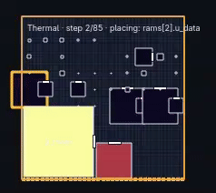
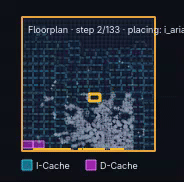

```
███╗   ██╗███████╗██╗   ██╗██████╗  ██████╗     ███████╗██╗██╗     ██╗ ██████╗ ██████╗ ███╗   ██╗
████╗  ██║██╔════╝██║   ██║██╔══██╗██╔═══██╗    ██╔════╝██║██║     ██║██╔════╝██╔═══██╗████╗  ██║
██╔██╗ ██║█████╗  ██║   ██║██████╔╝██║   ██║    ███████╗██║██║     ██║██║     ██║   ██║██╔██╗ ██║
██║╚██╗██║██╔══╝  ██║   ██║██╔══██╗██║   ██║    ╚════██║██║██║     ██║██║     ██║   ██║██║╚██╗██║
██║ ╚████║███████╗╚██████╔╝██║  ██║╚██████╔╝    ███████║██║███████╗██║╚██████╗╚██████╔╝██║ ╚████║
╚═╝  ╚═══╝╚══════╝ ╚═════╝ ╚═╝  ╚═╝ ╚═════╝     ╚══════╝╚═╝╚══════╝╚═╝ ╚═════╝ ╚═════╝ ╚═╝  ╚═══╝
```

<div align="center">

<p align="center">
  
</p>

# ⚡ NEUROSILICON

### *Autonomous AI Chip Floorplanning with Graph Neural Networks & Deep Reinforcement Learning*

<p align="center">
  <b>An open-source, interactive EDA workstation that places hard macros the way a learning agent plays a game — scored on wirelength, congestion, density, and thermal gradients live on your desktop.</b>
</p>

<p align="center">
  <a href="LICENSE"></a>
  <a href="https://www.python.org/"></a>
  <a href="https://pytorch.org/"></a>
  <a href="neurosilicon/tests/"></a>
  <a href="#-architectural-workflow"></a>
  <a href="#-native-workstation-gui"></a>
  <a href="#-open-eda-interoperability"></a>
</p>

---

</div>

## 💡 Overview: The Game of Silicon

Floorplanning is the pivotal first hour in physical chip design. Before standard cells can be placed and detailed signal wires can be routed, an engineer must position the massive building blocks — SRAM memories, register files, and execution cores — onto a bare silicon die. A mistake here locks in long wire delays, routing congestion hot spots, and thermal hazards that no downstream EDA pass can ever repair.

Traditionally, this critical step is held behind expensive commercial licensing, high-barrier scripting, and lengthy manual design iterations.

**NeuroSilicon re-imagines floorplanning as an open, observable, learning game:**

* 🎮 **Sequential Placement as a Reinforcement Learning MDP:** Macros are placed sequentially onto a 128×128 masked grid by an Edge-GNN policy trained with Masked PPO. Illegal placements are dynamically masked out in real time.
* ⚡ **Live Force-Directed Physics:** Standard cells continuously float and relax around placed macros, calculating transparent proxy costs (wirelength, density, RUDY routing congestion, and thermal gradients).
* 🤖 **Neuro AI Co-Pilot:** An integrated EDA intelligence capable of explaining physical trade-offs, enforcing conversational natural-language constraints, diagnosing bottlenecks, and executing a self-driving **Auto-Optimize Loop** (Baseline ➔ SAM Hotspot Diagnostics ➔ Constrained Re-Placement).
* 💻 **100% Open-Source & CPU-Native:** Free of commercial EDA license locks, closed binaries, or heavy cloud GPU dependencies. Runs from Verilog to placed DEF in minutes on standard Linux machines.

> [!NOTE]
> **Exploration, Not Signoff:** NeuroSilicon is built for the rapid exploratory phase *before* expensive signoff tooling is invoked. Every metric is an honest, mathematically rigorous proxy designed for interactive optimization.

---

## 🗺️ Architectural Workflow

```mermaid
flowchart LR
    classDef cIngestion fill:#0d2137,stroke:#0ea5e9,stroke-width:2px,color:#f8fafc;
    classDef cEngine fill:#241242,stroke:#a855f7,stroke-width:2px,color:#f8fafc;
    classDef cPolish fill:#062e2e,stroke:#14b8a6,stroke-width:2px,color:#f8fafc;
    classDef cAiLoop fill:#381e05,stroke:#f59e0b,stroke-width:2px,color:#f8fafc;
    classDef cOutputs fill:#06331e,stroke:#10b981,stroke-width:2px,color:#f8fafc;

    subgraph INGESTION ["1. Design Ingestion"]
        RTL["Verilog / SystemVerilog\n(e.g., Amber, Servant, Ibex)"]:::cIngestion --> YOSYS["Yosys Synthesis\n(Bundled / System)"]:::cIngestion
        YOSYS --> PROTO["Proto Netlist Builder\n(.pb.txt + .plc)"]:::cIngestion
        READY["Ready Netlist Pair\n(ariane, toy, picorv32)"]:::cIngestion --> PROTO
    end

    subgraph ENGINE ["2. AI Placement Engine"]
        PROTO --> MDP["Gymnasium 128x128 MDP"]:::cEngine
        MDP --> GNN["Edge-GNN Actor-Critic\n(PyTorch CPU)"]:::cEngine
        GNN --> MASK["Dynamic Legal Cell Masking"]:::cEngine
        MASK --> PLACE["Sequential Macro Placement"]:::cEngine
        PLACE --> RELAX["Force-Directed Standard-Cell Relaxation"]:::cEngine
    end

    subgraph POLISH ["3. Physical Polish & Kinetics"]
        RELAX --> SA["Simulated Annealing\nMacro Swaps"]:::cPolish
        SA --> FLIP["0° / 90° / 180° / 270°\nOrientation Optimizer"]:::cPolish
        FLIP --> PROXY["Multi-Objective Proxy Engine\nWirelength + RUDY Congestion + Density + Fmax"]:::cPolish
    end

    subgraph AI_LOOP ["4. Neuro AI & Autonomous Loop"]
        PROXY --> REVIEW["3-Agent Design Review\n(Thermal, Routing, Lead Architect)"]:::cAiLoop
        PROXY --> AUTOLOOP["⚡ Auto-Optimize Loop"]:::cAiLoop
        AUTOLOOP --> SAM["SAM Hotspot Segmentation"]:::cAiLoop
        SAM --> ADVICE["Bottleneck Diagnosis & RTL Advice"]:::cAiLoop
        ADVICE --> REPUTE["Constrained AI Re-Placement"]:::cAiLoop
    end

    subgraph OUTPUTS ["5. Export & Verification"]
        REPUTE --> DEF["Standard DEF Export\n(Flat & Viewer)"]:::cOutputs
        REPUTE --> TCL["OpenROAD Placement Script\n(.tcl with R0..R270)"]:::cOutputs
        REPUTE --> ROUTE["OpenROAD Global Route Validation\n(Optional Reality Check)"]:::cOutputs
    end

    style INGESTION fill:#0b1320,stroke:#0ea5e9,stroke-width:1.5px,color:#93c5fd
    style ENGINE fill:#150d24,stroke:#a855f7,stroke-width:1.5px,color:#d8b4fe
    style POLISH fill:#051b1b,stroke:#14b8a6,stroke-width:1.5px,color:#99f6e4
    style AI_LOOP fill:#201103,stroke:#f59e0b,stroke-width:1.5px,color:#fde68a
    style OUTPUTS fill:#051d12,stroke:#10b981,stroke-width:1.5px,color:#a7f3d0
```



---

## 🎬 Live Demonstrations: RISC-V Floorplanning in Action

Watch NeuroSilicon's Edge-GNN and real-time physics engine place macros and relax standard cells live across actual RISC-V chip designs:

<table align="center" width="100%">
  <tr>
    <th align="center" width="50%"><b>Sequential Macro Placement (RISC-V Core)</b></th>
    <th align="center" width="50%"><b>Force-Directed Physics & Congestion Optimization</b></th>
  </tr>
  <tr>
    <td align="center" width="50%">
      
      <br>
      <sub>▶️ <a href="docs/assets/chip_01.mp4"><b>Watch High-Resolution MP4 (chip 01.mp4)</b></a></sub>
    </td>
    <td align="center" width="50%">
      
      <br>
      <sub>▶️ <a href="docs/assets/chip_02.mp4"><b>Watch High-Resolution MP4 (chip 02.mp4)</b></a></sub>
    </td>
  </tr>
  <tr>
    <td align="center"><sub><b>Demo 1:</b> RL Agent placing hard macros sequentially on a 128×128 masked grid with real-time flylines.</sub></td>
    <td align="center"><sub><b>Demo 2:</b> Force-directed relaxation resolving cell density and RUDY routing congestion.</sub></td>
  </tr>
</table>

---

## 🚀 Silicon Valley & The AI Silicon Renaissance: What Nobody Has Done Before

> *"Software is eating the world, but AI is eating software — and custom silicon is eating AI."*

Across Silicon Valley and the global technology frontier, the race is on to build custom domain-specific silicon: Google TPU, Groq LPU, AWS Trainium, Apple Neural Engine, and open RISC-V AI accelerators. Yet, the physical design tools used to architect these groundbreaking chips remain fundamentally tethered to 30-year-old proprietary legacy software stacks — charging \$100,000+ per license, requiring massive compute server clusters, and demanding months of manual, opaque iteration.

**NeuroSilicon represents a fundamental paradigm shift: the world's first open-source, interactive, AI-native EDA workstation.**

### 🏆 Industry Firsts: Breaking New Ground in Silicon Design

1. 🥇 **From Supercomputers to Your Laptop (First CPU-Native RL Floorplanner)**
   Google's landmark AlphaChip paper (*Nature 2021*) proved that reinforcement learning could place chips better than human experts. However, its infrastructure was locked to massive distributed Reverb clusters, TensorFlow, and closed Google binaries. **NeuroSilicon is the first to liberate this technology** into a 100% open-source, Python 3.12+ and PyTorch-native engine that runs sequentially on any standard laptop CPU in minutes — zero GPU clusters and zero licenses needed.

2. 🥇 **First Real-Time Interactive Physics Canvas for EDA**
   Traditional EDA tools are batch-mode black boxes: you run a script, wait hours, and inspect a static report. NeuroSilicon is the **first EDA tool** with an interactive QPainter desktop workstation providing real-time physics simulation. Watch hard macros land live under the RL policy, scrub back and forth with playback kinetics, right-click to pin macros, and observe millions of standard cells dynamically float and relax around your manual overrides in real time.

3. 🥇 **First Closed-Loop Autonomous AI Co-Pilot (Neuro AI)**
   While other EDA tools experiment with passive chat wrappers that merely regurgitate documentation, **Neuro AI is the first closed-loop physical design intelligence**:
   * **Vision-Grounding:** Segments live congestion and thermal hotspots via SAM algorithms.
   * **RTL Architectural Diagnosis:** Pinpoints the exact bottleneck Verilog module causing timing or wirelength failure, and drafts synthesizable architectural patches (memory banking, pipeline slicing, clock gating).
   * **Closed-Loop Auto-Optimization:** Executes an autonomous 3-phase optimization loop (*Baseline ➔ SAM Diagnostics ➔ Constrained Re-Placement*) to actively beat human and heuristic baselines with verified PPA delta gains.

4. 🥇 **True Democratization of Silicon Innovation**
   Until now, custom silicon design was restricted to multi-billion-dollar corporations. NeuroSilicon bridges the gap between open-hardware RTL (RISC-V, OpenLane, Sky130) and cutting-edge deep reinforcement learning, empowering students, researchers, and pre-seed startup founders worldwide to design, simulate, and optimize custom chip floorplans from scratch on their own computers.

---

## 📊 How NeuroSilicon Compares

| Dimension | Commercial EDA Systems | AlphaChip (2021 Research Snapshot) | NeuroSilicon (v1.0.0 Workstation) |
| :--- | :--- | :--- | :--- |
| **Licensing** | Proprietary (\$100k+ / seat) | Research snapshot (TF/TF-Agents) | **100% Free & Open-Source (Apache 2.0)** |
| **Hardware** | Massive Server Clusters | Multi-GPU + Reverb distributed clusters | **Runs on any modern Linux Laptop / CPU** |
| **Interactivity** | Batch CLI / Heavy legacy GUI | Batch command-line scripts | **Native QPainter Desktop Workstation + Web UI** |
| **Design Ingestion** | Complex proprietary TCL scripts | Hardcoded Protobuf netlists | **Drag-and-Drop RTL, folders, or `.zip` files** |
| **AI Co-Pilot** | None / Generic cloud chatbot | None | **Neuro AI (Conversational, Tool-Grounded, Offline)** |
| **Self-Optimization** | Manual engineering iterations | Offline RL training scripts | **⚡ One-Click Autonomous Auto-Optimize Loop** |
| **Technology Nodes** | Closed proprietary PDKs | Hardcoded technology parameters | **Sky130, ASAP7, GF180MCU dynamic presets** |

---

## 🌟 Key Highlights

### 🖥️ Native Workstation GUI
* **Multi-Layer QPainter Canvas:** Inspect floorplans with sub-millisecond redraws across **Floorplan**, **Congestion (RUDY)**, **Thermal**, **Flightlines (Wires)**, and **Baseline vs. AI Compare** split-views.
* **Interactive Kinetics:** Step through placement rollouts with Play/Pause, speed control, and scrub bars.
* **Macro Pinning:** Right-click or drag macros to lock them in place while the RL policy places remaining components around them.

### 🧠 Neuro AI Assistant
* **Context-Aware Insights:** Grounded in live simulation metrics (never hallucinates file writes or placement numbers).
* **Conversational Constraints:** Speak your physical intent (*"Keep a 20% routing channel open in the center"* or *"Spread hot macros to the perimeter"*).
* **Type-Ahead & Suggestion Dropdown:** Auto-completes design queries with intelligent engineering presets.
* **100% Offline Resilience:** Operates with a deterministic rule-based engine when no LLM is configured; effortlessly connects to local **Ollama** / **LM Studio** or cloud API endpoints when desired.

### ⚡ Autonomous Auto-Optimize Loop
Press **⚡ Auto-Optimize (AI Loop)** to launch an autonomous three-phase refinement:
1. **Phase 1: Baseline Acquisition** ➔ Simulates heuristic or unconstrained rollouts.
2. **Phase 2: SAM Segmentation & Diagnosis** ➔ Pinpoints congestion centers, identifies bottleneck hard macros, and formats constraint keep-out zones.
3. **Phase 3: AI-Guided Re-Placement** ➔ Enforces optimal placement, executes simulated annealing, and presents a **PPA Improvement Summary** with side-by-side delta badges.

### 🛠️ RTL Co-Pilot & 3-Agent Review
* **RTL Synthesis Co-Pilot:** Identifies thermal/wirelength bottleneck instances, locates their source Verilog, and generates synthesizable architectural patches (memory banking, pipeline slicing, clock gating).
* **3-Agent Review:** Simulates an engineering review board (*Thermal Engineer*, *Routing Specialist*, *Lead Architect*) to dynamically balance proxy cost weights.

---

## 🚀 Quick Start (in Under 2 Minutes)

### 1. Clone & Set Up Virtual Environment

```bash
# Clone the repository
git clone https://github.com/IndhirajithHari/neuro-silicon.git
cd neuro-silicon

# Create an isolated Python 3.12+ environment
python3 -m venv .venv

# Install dependencies (CPU PyTorch keeps it light and portable)
.venv/bin/pip install numpy scipy matplotlib pytest gymnasium absl-py \
    gin-config streamlit PySide6 Pillow
.venv/bin/pip install --index-url https://download.pytorch.org/whl/cpu torch

# Avoid sandbox cache warnings
export MPLCONFIGDIR=/tmp/mpl
```

### 2. Verify with the Test Suite

```bash
MPLCONFIGDIR=/tmp/mpl .venv/bin/python -m pytest neurosilicon/tests/ -q
```
*Expected Result:* **136 passed, 1 skipped** *(openc906 skips until imported)*.

### 3. Launch the Desktop Workstation

```bash
.venv/bin/python -m neurosilicon.desktop
```

*(For headless servers or remote SSH, launch with `QT_QPA_PLATFORM=offscreen` or use the Web Console below).*

### 4. Or Launch the Streamlit Web Console

```bash
.venv/bin/python -m streamlit run neurosilicon/app.py --server.port 8765
```
Open **`http://localhost:8765`** in your browser.

---

## 📦 Ingesting Custom Designs

You can bring your own chip from RTL to floorplan across four flexible ingestion methods:

| Ingestion Method | How It Works | Ideal Usage |
| :--- | :--- | :--- |
| **Drag & Drop** | Drag any folder, `.v`/`.sv` file, or `.zip` directly onto the workstation window | Rapid testing of external open-source cores |
| **Neuro AI Chat Button** | Open the right panel ➔ **Neuro AI** ➔ click `Import project file…` | Guided, interactive import while chatting |
| **Conversational Command** | Type `import /path/to/my_chip_rtl` directly in the chat box | Fast keyboard-driven workflow |
| **Import Tab** | Select Center Panel ➔ **Import** ➔ Browse ➔ Auto-Detect ➔ Import | Deep review of detected top modules and hierarchy |

* **Ready Netlists (`.pb.txt` + `.plc`):** Registers in milliseconds with zero synthesis overhead.
* **Raw RTL (`.v` / `.sv`):** NeuroSilicon automatically discovers module hierarchies, detects top modules, filters testbenches, runs Yosys synthesis, and generates floorplanning netlists on the fly.
* **Pre-bundled Reference Chips:** Includes `toy` (2 macros), `ariane` (133 macros), `servant SoC` (Sky130), `picorv32`, `picosoc`, and `ultraembedded riscv_core`.

---

## 🔌 AI Connectors (Optional & Privacy-First)

NeuroSilicon works **100% offline out-of-the-box**. No API keys are required. If you want to connect a foundation model, open **Connectors** in the desktop right panel:

* **Local & Private:** Connect to **Ollama** (`http://localhost:11434`) or **LM Studio** (`http://localhost:1234/v1`). Zero tokens leave your workstation.
* **Cloud API:** Point to any OpenAI-compatible inference gateway (API Key + Base URL + Model Name).
* **Storage Safety:** Credentials are saved exclusively in your personal `~/.config/neurosilicon/settings.json` (strictly isolated from git tracking).

---

## 📁 Repository Layout

| Directory / File | Description |
| :--- | :--- |
| `neurosilicon/desktop.py` | Native PySide6 Qt Workstation (Canvas, Pins, Compare, Exports) |
| `neurosilicon/app.py` | Modern Streamlit Web Console |
| `neurosilicon/env.py` | Gymnasium 128×128 placement MDP |
| `neurosilicon/model.py` & `train.py` | Edge-GNN PyTorch policy & masked PPO trainer |
| `neurosilicon/liveplace.py` | Physics relaxation, RUDY congestion, SAM hotspots, Fmax |
| `neurosilicon/assistant.py` & `llm.py` | Neuro AI conversational engine & LLM connectors |
| `neurosilicon/priors.py` | Constraint masks, thermal penalties, routing channels |
| `neurosilicon/tech.py` | Sky130 / ASAP7 / GF180MCU technology presets |
| `neurosilicon/project.py` | Yosys RTL synthesis & project discovery pipeline |
| `neurosilicon/render.py` & `export_def.py` | High-res plotting & standard DEF/TCL exporters |
| `neurosilicon/tests/` | 19 comprehensive test suites (136 tests) |
| `neurosilicon/thirdparty/tilos/` | Vendored open-source placement cost engine (BSD-3) |
| `circuit_training/` | Upstream AlphaChip reference (provenance only) |
| `docs/` | Technical specs, blockages, netlist formats, and feature guides |
| `tools/` | Yosys, OpenROAD, and container tool shims |
| `NEUROSILICON_HOW_IT_WORKS.md` | Mathematical & algorithmic deep dive |
| `CHANGELOG.md` | Detailed release notes |

---

## ⚙️ CLI Power Tools

For researchers, batch experiments, and automated pipelines:

```bash
# 1. Run baseline placement evaluations (Random / First-Legal / Heuristics)
MPLCONFIGDIR=/tmp/mpl .venv/bin/python -m neurosilicon.evaluate \
  --netlist circuit_training/environment/test_data/toy_macro_stdcell/netlist.pb.txt \
  --init_placement circuit_training/environment/test_data/toy_macro_stdcell/initial.plc \
  --episodes 10 --outdir logs/cli_baseline

# 2. Train the Edge-GNN Policy via Masked PPO
MPLCONFIGDIR=/tmp/mpl .venv/bin/python -m neurosilicon.train \
  --netlist circuit_training/environment/test_data/toy_macro_stdcell/netlist.pb.txt \
  --init_placement circuit_training/environment/test_data/toy_macro_stdcell/initial.plc \
  --outdir logs/cli_train --iterations 5 --episodes_per_iter 4
```

---

## 📜 History & Provenance

NeuroSilicon stands on the shoulders of Google Research's landmark **AlphaChip / Circuit Training** project (*Mirhoseini et al., Nature 2021*), whose 291 foundational commits remain preserved in `circuit_training/`.

NeuroSilicon modernizes this legacy into a lightweight, Python-native engine:
1. **Commit `54dcd45`:** Replaced the TensorFlow, TF-Agents, and proprietary binary stack with an open Python-native runtime over the vendored TILOS PLC core, introducing the PyTorch Edge-GNN, Gymnasium MDP, Yosys import pipeline, and initial GUI.
2. **Commit `91a7772`:** Engineered the full EDA workstation upgrade: real-time QPainter canvas, SAM hotspot segmenter, ⚡ Auto-Optimize loop, Technology Node presets, orientation flipping (`R0..R270`), and PPA metric suite.
3. **Commit `17d365c`:** Introduced **Neuro AI**, suggestion dropdowns with type-ahead completion, direct chat import, and exhaustive feature documentation.

---

## 🤝 Contributing & License

We believe open hardware requires truly open EDA tools. Contributions of all kinds — GNN policy enhancements, new technology presets, macro placers, or UI upgrades — are warmly welcomed!

* **Code of Conduct:** See [CODE_OF_CONDUCT.md](CODE_OF_CONDUCT.md).
* **Contributing Guidelines:** See [CONTRIBUTING.md](CONTRIBUTING.md).
* **License:** Licensed under the [Apache License, Version 2.0](LICENSE). Third-party vendored components maintain their original permissive licenses.

<p align="center">
  <sub><b>NeuroSilicon</b> — Place smarter. Explore faster. Keep silicon design open.</sub>
</p>
